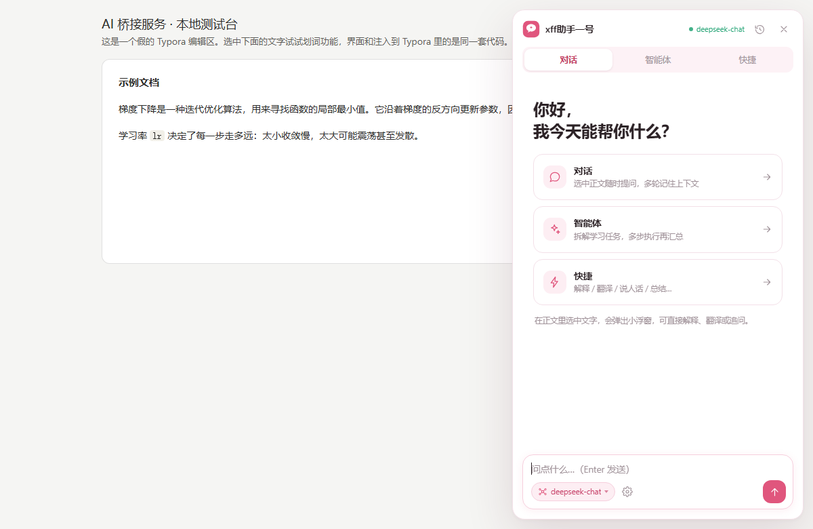
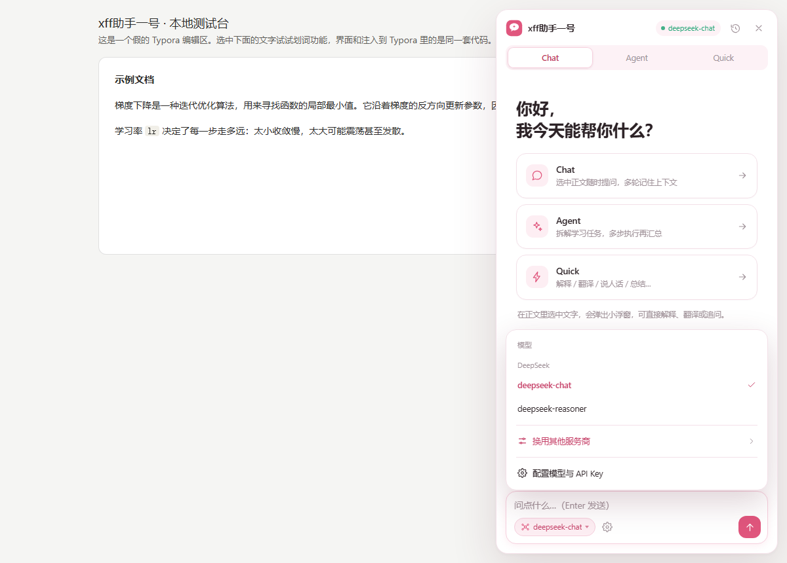
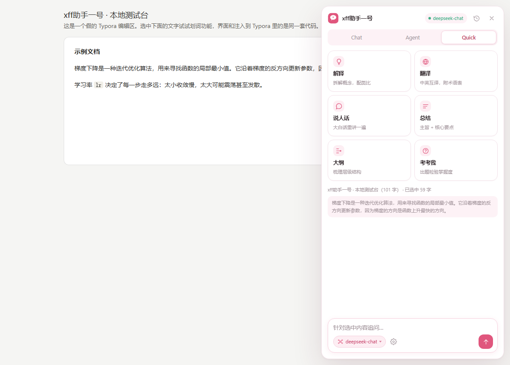
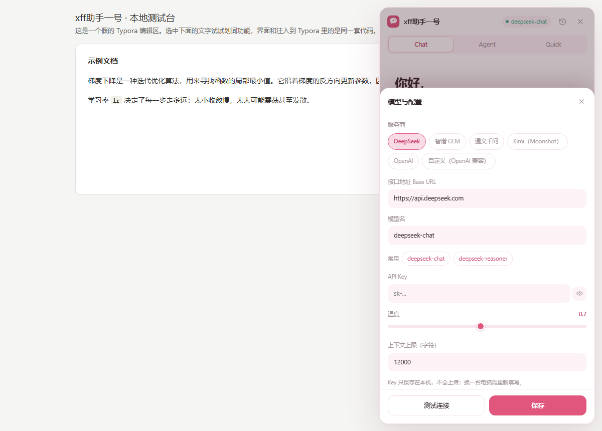

# xff助手一号

给 **Typora** 装一个 AI 学习助手侧栏：读文档时随时问、随手划词就能解释/翻译/出题。
淡粉主题、纯色无渐变。

**核心特点：不需要任何后台进程。** 打开 Typora 插件自动出现，渲染进程直连 AI 服务，
不占端口、不用常驻服务、重启电脑也不用管它。

<p align="center">
  
  
</p>
<p align="center">
  
  
</p>

---

## 功能

**三种模式**（顶部分段切换）

| 模式 | 用途 |
| --- | --- |
| 对话 | 多轮聊天，自动带上当前文档上下文 |
| 智能体 | 给一个学习任务，自动拆成 2~4 步依次执行，逐步展示 |
| 快捷 | 解释 / 翻译 / 说人话 / 总结 / 大纲 / 考考我，一键出结果 |

**划词浮窗**：在正文里选中一段文字，就地弹出「解释 / 翻译 / 说人话 / 总结」，
不打断阅读，也不会挡住 Typora 自带的右键菜单。

**输出落地**：回答可以一键复制，或直接以引用块插回文档。

**模型随便换**：内置 DeepSeek、智谱 GLM、通义千问、Kimi、OpenAI 以及任何
OpenAI 兼容服务的预设，在输入框左下角的下拉里直接切；API Key 在面板里填，
**只存在本机**（Typora 的本地存储），不会上传、不会进代码仓库。

**跟随主题**：自动识别 Typora 的浅色/深色主题。

---

## 安装

### 方式一：用安装包（推荐）

1. 下载 Releases 里的 `typora-ai-assistant-v2.5.0.zip`，**解压**（不要直接在压缩包里运行）
2. 双击 `installer\install.bat`
3. UAC 弹窗点「是」（要写 Typora 安装目录，必须管理员权限）
4. 重启 Typora

装完打开 Typora，右下角会出现悬浮球（或按 `Ctrl+Alt+K`）；
第一次打开面板会自动提示填 API Key。

### 方式二：手动安装

把 `plugin\` 里的 `inject.js`、`client.js`、`client.css`、`config.example.json`（改名 `config.json`）
复制到：

```
<Typora 安装目录>\resources\app\typora-ai-bridge\
```

然后在该目录的 `window.html` 里，`</body>` 之前加一行：

```html
<script src="./typora-ai-bridge/inject.js"></script>
```

> `window.html` 是 **UTF-8 无 BOM** 编码，改完别让编辑器加 BOM，否则 Typora 可能白屏。

### 要求

- **Typora**：实质要求是渲染进程暴露 `window.reqnode`；安装脚本会自动检测并提示
- **Windows**：安装脚本是 PowerShell（macOS / Linux 可按方式二手动安装）
- **Node.js**：不需要。插件跑在 Typora 自带的 Node 环境里

### 内嵌浏览器版本（很容易踩的坑）

插件的界面跑在 Typora 自己的渲染进程里，用的就是 Typora 内置的 Chromium，
**不是**你系统里的 Chrome / Edge。Typora 1.8.3 内嵌的是 **Electron 1.8.3 → Chromium 59（2017 年）**，
所以界面代码必须写得足够「老」：

| 不要用 | 原因 | 本项目的替代做法 |
| --- | --- | --- |
| `inset: 0` | Chromium 87+ 才有 | 显式写 `top/right/bottom/left: 0` |
| flex 容器的 `gap` | Chromium 84+ 才有 | `client.css` 末尾的「兼容层」用 `margin` 实现 |
| grid 的 `gap` 简写 | Chromium 66+ 才有 | 用 `grid-gap`（Chromium 57+） |
| `:focus-within` | Chromium 60+ 才有 | JS 给元素加 `.focus` 类 |
| 箭头函数 / `?.` / `??` / 对象展开 | V8 太新 | 全部写 ES5，新 API 先做特性检测 |

`client.css` 里所有间距都**只用 `margin` 和 `padding`**；改动样式后请用
`docs/` 下的无头截图流程在「模拟旧内核」的 CSS 上回归一次，避免又踩回同一个坑。

---

## 使用

| 操作 | 说明 |
| --- | --- |
| `Ctrl+Alt+K` | 打开 / 关闭面板 |
| 点右下角悬浮球 | 同上（可拖动，位置会记住） |
| 选中正文文字 | 弹出划词浮窗 |
| `Enter` | 发送；`Shift+Enter` 换行 |
| 输入框左下角 | 切换模型 |
| 输入框右侧齿轮 | 配置服务商 / Base URL / 模型 / API Key |

**第一次使用要填 API Key**：点齿轮 → 选服务商 → 填 Key →「测试连接」→「保存」。
以 DeepSeek 为例，Key 在 <https://platform.deepseek.com/api_keys> 申请。

---

## 配置

配置有两处，优先级从高到低：

1. **面板里填的**（推荐）—— 存在本机 Typora 的 localStorage，换电脑要重填
2. **`config.json`** —— 安装目录里的文件，适合批量部署

```jsonc
{
  "provider": "deepseek",
  "baseUrl": "https://api.deepseek.com",
  "model": "deepseek-chat",
  "apiKey": "",                 // 留空就在面板里填
  "temperature": 0.7,
  "maxContextChars": 12000      // 传给 AI 的文档上下文上限（字符）
}
```

改完 `config.json` 需要重启 Typora。

内置预设（Base URL 已填好，只需补 Key）：

| 服务商 | Base URL |
| --- | --- |
| DeepSeek | `https://api.deepseek.com` |
| 智谱 GLM | `https://open.bigmodel.cn/api/paas/v4` |
| 通义千问 | `https://dashscope.aliyuncs.com/compatible-mode/v1` |
| Kimi（Moonshot） | `https://api.moonshot.cn/v1` |
| OpenAI | `https://api.openai.com/v1` |

任何其他 OpenAI 兼容服务，选「自定义」填 Base URL 和模型名即可。

---

## 卸载

双击 `installer\uninstall.bat`（同样需要管理员权限）。它会用
`window.html.bak` 还原注入前的内容，并删除 `typora-ai-bridge` 目录。

---

## 工作原理

```
Typora 启动
   │  读取 window.html（注入了一行 <script src="./typora-ai-bridge/inject.js">）
   ▼
inject.js  ← 唯一装进 Typora 的文件，只做引导
   │
   ├─ 通道 A（可选）：本机 8765 端口有桥接服务 → 从它拉最新界面（支持热更新）
   │
   └─ 通道 B（默认）：直接读同目录的 client.js / client.css / config.json
          │
          ▼
      client.js 在 Typora 渲染进程里运行
          │  用 window.reqnode('https') 直连 AI 服务（SSE 流式）
          ▼
      DeepSeek / 智谱 / 通义 / Kimi / OpenAI …
```

两条通道的好处：日常走通道 B，**零后台、零端口**；
开发时开桥接服务（通道 A），改完前端刷新即可生效，不用重装。

`bridge/` 是可选的桥接服务，普通用户完全用不到，
跑起来还能当**本地测试台**：`node bridge/server.js` 然后打开 <http://127.0.0.1:8765>。

---

## 目录结构

```
plugin/          插件本体（唯一要装进 Typora 的东西）
  inject.js        引导脚本
  client.js        界面 + 逻辑（对话/智能体/快捷、直连 AI）
  client.css       样式
  config.example.json
installer/       安装 / 卸载脚本（双击 .bat）
bridge/          可选的本地桥接服务 + 测试台（开发者用）
assets/          图标
docs/            截图
build-release.ps1  打包成可分发 zip
```

---

## 常见问题

**装了没反应 / 右下角没有悬浮球？**
确认注入是否生效：在 Typora 安装目录的 `window.html` 里搜 `typora-ai-bridge`。
没有就重跑一次 `install.bat`（Typora 升级会覆盖 `window.html`，升级后要重跑）。

**回答报 401 / Unauthorized？**
API Key 不对或过期。点齿轮重新填，用「测试连接」验证。

**回答报 404？**
模型名或 Base URL 不对。检查是否和所选服务商匹配。

**提示"还没有配置 API Key"？**
第一次使用需要自己填 Key，插件不自带。

**面板打不开 / Typora 白屏？**
先关闭 Typora，用 `installer\uninstall.bat` 还原，再检查是不是 `window.html`
被编辑器加上了 BOM。

**换电脑怎么办？**
整个文件夹拷过去，在新电脑上重新双击 `install.bat`，然后填自己的 Key。
**不要**把 `bridge\config.json`（可能存着 Key）连同安装包一起发出去。

---

## 开发

```bash
# 本地测试台（不用装 Typora 也能看界面）
node bridge/server.js
# 浏览器打开 http://127.0.0.1:8765
#   加 ?tab=quick&run=explain  直接跑一次「解释」
#   加 ?tab=chat&pop=model     直接展开模型下拉
#   加 #open                   打开面板

# 打包
powershell -ExecutionPolicy Bypass -File build-release.ps1

# 提交前跑两个回归检查（都必须通过）
node scripts/compat-check.js   # 扫描有没有用 Chromium 59 不认识的新语法
node scripts/xss-probe.js      # 渲染层 XSS 回归，应输出「风险用例数: 0」
```

改 `plugin/client.js` 后：走桥接模式刷新即可；直连模式需要重跑 `install.bat`。

**为什么必须有 `compat-check.js`**：界面跑在 Typora 内嵌的 Chromium 59 里，
而这台机器上的 Chrome / Edge 是新版 —— 本地看着好好的，进 Typora 就散架。
改动界面后用「模拟旧内核」的 CSS（把所有新语法声明整条删掉）再截一次图对比，
是现代内核发现不了问题的唯一可靠办法。

---

## License

MIT
